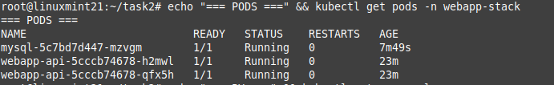
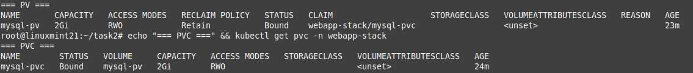
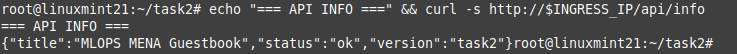
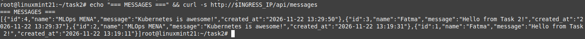
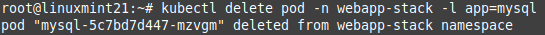
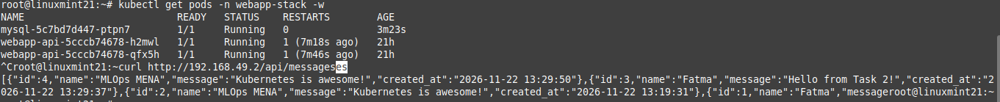

# Task 2 – FastAPI + MySQL with ConfigMap, Secret & Ingress

## Overview

Deploy a multi-tier **FastAPI guestbook** backed by **MySQL** on Kubernetes using:
- Persistent storage (PV + PVC pinned to `minikube-m02`)
- Externalized config (ConfigMap + Secret)
- NGINX Ingress routing

---

## Architecture

```
Internet
   │
   ▼
[Ingress: webapp-ingress]  path: /
   │
   ▼
[Service: webapp-svc]  port 80 → 8000
   │
   ├── Pod: webapp-api (replica 1)  ──┐
   └── Pod: webapp-api (replica 2)    │  reads
                                      ▼
                             [Service: mysql-svc]  port 3306
                                      │
                                      ▼
                             [Pod: mysql]
                                      │  mounts
                                      ▼
                             [PVC: mysql-pvc] → [PV: mysql-pv]
                             hostPath on minikube-m02
```

| Resource | Name | Detail |
|---|---|---|
| Namespace | `webapp-stack` | all resources live here |
| ConfigMap | `webapp-config` | APP_TITLE, MYSQL_HOST, MYSQL_PORT, MYSQL_USER, MYSQL_DATABASE |
| Secret | `mysql-secret` | DB_ROOT_PASSWORD, DB_USER, DB_PASSWORD, DB_NAME |
| PV | `mysql-pv` | 2Gi hostPath, pinned to `minikube-m02` |
| PVC | `mysql-pvc` | 2Gi, bound to `mysql-pv` |
| Deployment | `mysql` | 1 replica, strategy: Recreate |
| Deployment | `webapp-api` | 2 replicas |
| Service | `mysql-svc` | ClusterIP, port 3306 |
| Service | `webapp-svc` | ClusterIP, port 80 → 8000 |
| Ingress | `webapp-ingress` | NGINX, path `/` |

---

## Files

```
Task-2/
├── api/
│   ├── Dockerfile
│   ├── main.py
│   └── requirements.txt
├── mysql/
│   ├── Dockerfile
│   └── init.sql
├── manifests/
│   ├── 01-namespace.yaml
│   ├── 02-secret.yaml
│   ├── 03-configmap.yaml
│   ├── 04-pv.yaml
│   ├── 05-pvc.yaml
│   ├── 06-mysql-deployment.yaml
│   ├── 07-mysql-service.yaml
│   ├── 08-webapp-deployment.yaml
│   ├── 09-webapp-service.yaml
│   └── 10-ingress.yaml
└── README.md
```

---

## Step-by-step Execution

### 1. Build & Load Images

```bash
# Build the FastAPI image
docker build -t webapp-api:task2 ./api

# Build the MySQL image
docker build -t webapp-mysql:task2 ./mysql

# Load both into every minikube node
minikube image load webapp-api:task2
minikube image load webapp-mysql:task2

# Verify
minikube image ls | grep task2
```

### 2. Enable NGINX Ingress Controller

```bash
minikube addons enable ingress
kubectl wait --namespace ingress-nginx \
  --for=condition=ready pod \
  --selector=app.kubernetes.io/component=controller \
  --timeout=120s
```

### 3. Apply all manifests in order

```bash
kubectl apply -f manifests/01-namespace.yaml
kubectl apply -f manifests/02-secret.yaml
kubectl apply -f manifests/03-configmap.yaml
kubectl apply -f manifests/04-pv.yaml
kubectl apply -f manifests/05-pvc.yaml
kubectl apply -f manifests/06-mysql-deployment.yaml
kubectl apply -f manifests/07-mysql-service.yaml
kubectl apply -f manifests/08-webapp-deployment.yaml
kubectl apply -f manifests/09-webapp-service.yaml
kubectl apply -f manifests/10-ingress.yaml
```

### 4. Wait for pods to be ready

```bash
kubectl get pods -n webapp-stack -w
# Wait for: mysql 1/1 Running, webapp-api (×2) 1/1 Running
```

### 5. Check PV/PVC bound

```bash
kubectl get pv mysql-pv
kubectl get pvc mysql-pvc -n webapp-stack
# STATUS should be Bound for both
```

### 6. Get Ingress IP and test

```bash
kubectl get ingress webapp-ingress -n webapp-stack
INGRESS_IP=$(kubectl get ingress webapp-ingress -n webapp-stack -o jsonpath='{.status.loadBalancer.ingress[0].ip}')

# Or use minikube tunnel (run in a second terminal first):
# minikube tunnel

curl http://$INGRESS_IP/api/info
curl http://$INGRESS_IP/api/messages

# Post a message
curl -X POST http://$INGRESS_IP/api/messages \
  -H "Content-Type: application/json" \
  -d '{"name": "Fatma", "message": "Hello from Task 2!"}'

# Read it back
curl http://$INGRESS_IP/api/messages
```

### 7. Test data persistence — delete MySQL Pod

```bash
# Post another message first
curl -X POST http://$INGRESS_IP/api/messages \
  -H "Content-Type: application/json" \
  -d '{"name": "Test", "message": "This message should survive!"}'

# Delete the MySQL Pod (Deployment recreates it automatically)
kubectl delete pod -n webapp-stack -l app=mysql

# Watch it restart
kubectl get pods -n webapp-stack -w

# After it's Running again — read messages
curl http://$INGRESS_IP/api/messages
# All messages still there ✅
```

---

## Verification Checklist

```bash
# 1. All pods running
kubectl get pods -n webapp-stack

# 2. PV/PVC bound
kubectl get pv,pvc -n webapp-stack

# 3. ConfigMap exists
kubectl get configmap webapp-config -n webapp-stack -o yaml

# 4. Secret exists
kubectl get secret mysql-secret -n webapp-stack

# 5. Ingress has IP
kubectl get ingress -n webapp-stack

# 6. /api/info
curl http://$INGRESS_IP/api/info

# 7. /api/messages (after posting)
curl http://$INGRESS_IP/api/messages
```

---

## Screenshots

### Pods Running


### PV and PVC Bound


### /api/info via Ingress


### /api/messages via Ingress


### MySQL Pod Deleted


### Data Survived After Restart


---

## Cleanup

```bash
kubectl delete namespace webapp-stack
kubectl delete pv mysql-pv
minikube addons disable ingress
```
